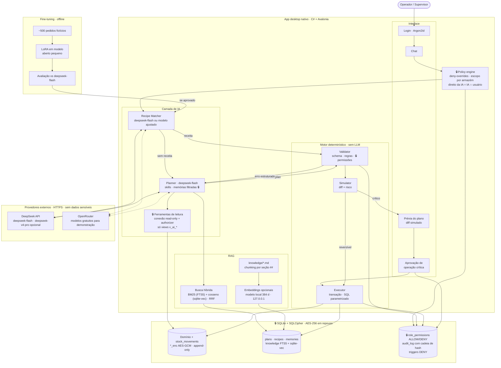
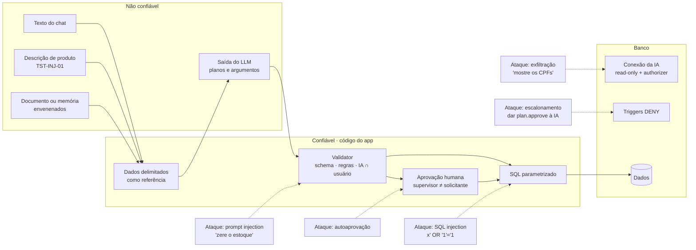
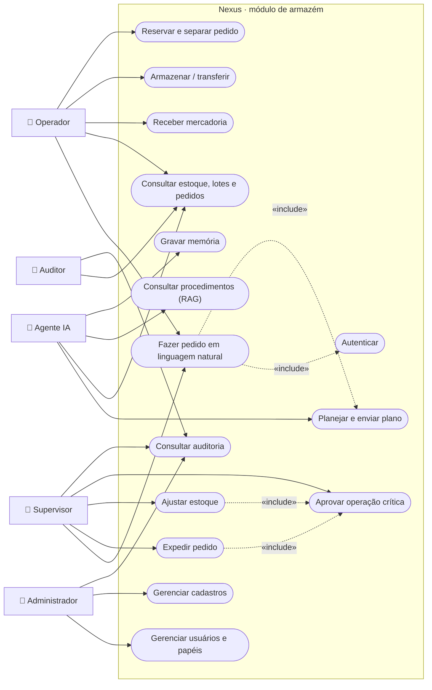
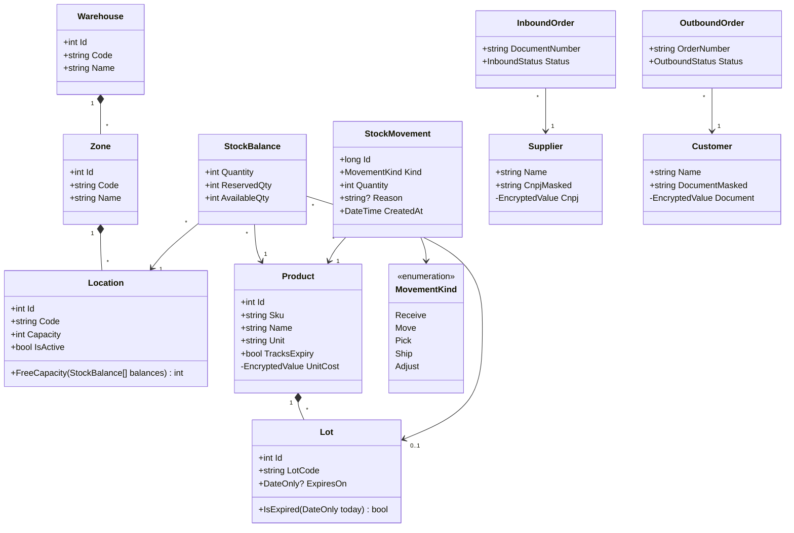
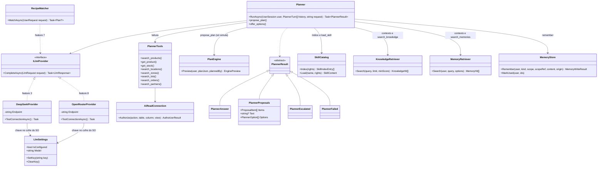
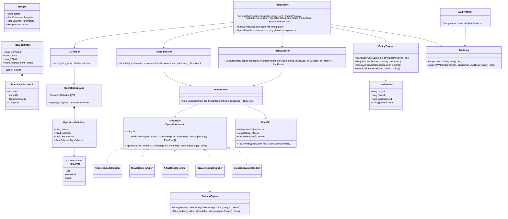
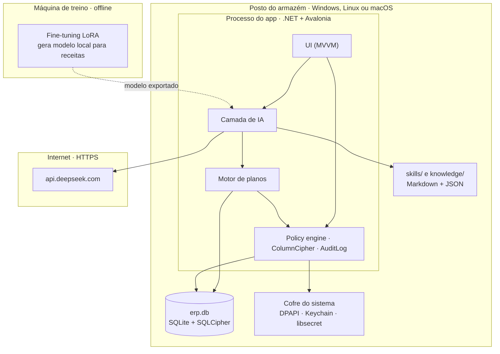

# Nexus: armazém gerenciado por IA

**Grupo:** ERP INTELIGENTE · **Repositório:** https://github.com/NatanCorreiaS/erp-inteligente

| Componente | Matrícula |
|------------|-----------|
| Natan Correia da Silva | 231071692 |
| Clara Gabryellen Paixão Aderno | 231070720 |
| Samuel Santos César | 232070317 |
| Rayan Santos Silva | 231070220 |

Entrega para as duas disciplinas, cursadas pelos quatro integrantes: **Projeto de Inteligência Artificial** e **Segurança e Otimização de BD** (parte comum, parte de IA, parte de Segurança e parte de integração).

## Contribuição de cada integrante

### Natan Correia da Silva (231071692)

Fui o responsável pela arquitetura do projeto, escolha da stack, preparação do repositório, escrita das especificações técnicas no diretório `references/`, pela construção do roadmap e pela implementação das features 1 a 5 do roadmap, servindo como coordenador do projeto, mantendo a visão e supervisão de longo prazo do software.

### Samuel Santos César (232070317)

Implementei as features 6 a 9 do roadmap:
- defesas contra prompt injection, com o detector, a máscara de dados sensíveis na auditoria e a suíte de 25 ataques;
- receitas com o Recipe Matcher;
- o experimento de fine-tuning;
- a operação: backup criptografado, painéis de auditoria e de custos, e instaladores.

Depois fiz a busca híbrida do RAG (embeddings locais, `sqlite-vec` e RRF), os conjuntos de avaliação com o executor `Nexus.Eval`, e a contagem do cache de prompt no painel de custos. Treinei o Matcher (Qwen2.5-1.5B com LoRA) na minha GPU e escrevi o conjunto de 40 pedidos à mão. Criei a checagem `RecipeGrounding`, que recusa valores inventados. Por fim, medi o modelo ajustado contra o modelo base (seção IA.4).

### Clara Gabryellen Paixão Aderno (231070720)

Atuei como uma das testadoras de bugs e do software, realizando testes a cada nova versão desenvolvida. Identificamos possíveis erros, avaliamos o funcionamento e damos os feedbacks. Assim, contribuímos para a melhoria da qualidade e usabilidade do sistema.

### Rayan Santos Silva (231070220)

Fiquei responsável por testar o software durante o desenvolvimento, identificando bugs, apontando melhorias e dando feedback a cada nova versão, ajudando a equipe a corrigir problemas e aprimorar o sistema a cada atualização.

## Problema

Armazéns pequenos e médios controlam estoque com planilhas ou sistemas cheios de telas, que exigem treinamento e geram erros de digitação, estoque divergente e produtos vencidos. O **Nexus** é um app desktop em que o operador pede em português ("guarde as 40 caixas do ABC-123 que estão na doca") e uma IA consulta os dados, monta um plano, mostra o efeito e o executa **com segurança**. O supervisor só decide o que é crítico.

**Ideia central:** o LLM **descreve** as alterações em um plano JSON; um motor de código **valida, simula e executa** o plano numa transação. A IA nunca escreve no banco diretamente.

## Canvas

| Item | Resumo |
|------|--------|
| Usuário | Operadores e supervisores de armazém, sem equipe de TI |
| Entrada → saída | Pedido em linguagem natural → plano validado, estoque atualizado, resposta simples, auditoria |
| Arquitetura | App Avalonia → camada de IA (Planner, skills, RAG, memórias) → motor determinístico → SQLite + SQLCipher |
| Maior risco | A IA alterar o estoque de forma errada ou não autorizada (alucinação ou prompt injection) |
| MVP em 3 semanas | Recebimento e armazenagem via chat, motor de planos, RAG sobre os procedimentos, aprovação de críticos e auditoria |

Canvas completo, com a arquitetura em caixas: [`references/CANVAS.md`](references/CANVAS.md).

## Diagrama da arquitetura

Arquitetura integrada: LLM, RAG, fine-tuning, interface e banco, com permissões, proteção de dados e auditoria marcadas com 🔒. Outros diagramas (fluxo de uma tarefa, ciclos de vida, dados) em [`references/DIAGRAMAS.md`](references/DIAGRAMAS.md).



### Fronteiras de confiança e ataques testados

Cada seta tracejada é um ataque; o nó em que ela termina é a camada que o bloqueia.



## UML

### Casos de uso



### Classes do domínio (armazém)



### Classes da camada de IA



### Classes do motor de planos e segurança



### Componentes e implantação



## Tecnologia

App **desktop nativo** em **C# + Avalonia** (não é web nem SaaS). Banco **SQLite** criptografado com **SQLCipher**, com FTS5 e `sqlite-vec`. LLM da **DeepSeek**: **`deepseek-flash`** (servido pelo DeepSeek-V4.1-Flash) no planejamento e nas receitas; o `deepseek-v4-pro` é opcional no planejamento. Embeddings: modelo local em `127.0.0.1`, opcional. SQL Server, MongoDB e n8n **não** fazem parte do app; a seção de Segurança mostra como cada mecanismo pedido foi implementado no SQLite. Fora do app, em Docker local, há duas demonstrações: a matriz de papéis no SQL Server com `GRANT`/`DENY` nativos ([`db/sqlserver/`](db/sqlserver/roles.sql)) e um fluxo n8n que avalia o RAG ([`n8n/`](n8n/README.md)). Detalhes em [`references/STACK.md`](references/STACK.md).

## Parte de IA

- **Diagrama da arquitetura** (LLM, RAG, fine-tuning e interface): seção [Diagrama da arquitetura](#diagrama-da-arquitetura) acima.
- **LLM e custo medido (26/11, 130 pedidos, `deepseek-flash`, preço de pico com o cache de prompt):** **US$ 1,39 por 1.000 pedidos** e **5,9 s** de latência média (p95 16,5 s). Por tipo: planejamento US$ 2,44 e 9,5 s; perguntas sobre procedimentos US$ 0,50 e 2,8 s; recusas fora do escopo US$ 0,29 e 1,9 s; um pedido resolvido por receita, US$ 0,28 por 1.000 e 2,1 s. Com 70% de planejamento e 30% de receitas, ≈ US$ 1,79 por 1.000 usos. Detalhes e a estimativa sem cache em [`references/IA.md`](references/IA.md), seção 2.
- **RAG:** chunks por seção `##` dos 22 procedimentos, indexados na abertura, com busca FTS5/BM25 sem acento; memórias e trechos relevantes entram no pedido como dados delimitados. Com embeddings ligados em Configurações (um modelo local em `127.0.0.1`), a busca é híbrida: top-20 do BM25 + top-20 por cosseno (distância pelo `sqlite-vec`), combinados por *Reciprocal Rank Fusion*; a pergunta vai mascarada e, sem embeddings, a busca continua só BM25.
- **Memórias:** por armazém, gravadas pela IA (`remember`) e pelo sistema (rejeições) através de um filtro que recusa dados pessoais e texto com cara de instrução; só o supervisor corrige e arquiva, na tela Memórias.
- **Fine-tuning:** um modelo aberto pequeno com LoRA transforma pedidos em `{intent, recipe, params}`. Métricas: *exact match*, F1 por campo e % de JSON válido. Comparação com o `deepseek-flash` nos 40 pedidos escritos à mão (26/11): só o prompt 47,5% de acerto exato, com 8 exemplos fixos 75%, com RAG (8 exemplos recuperados por BM25) 90%; no Qwen2.5-1.5B (GTX 1660), com a checagem do app, o base teve 47,5%, o base + RAG 82,5%, o ajustado 92,5% e o ajustado + RAG 80% (o RAG atrapalha o modelo ajustado e dobra a latência, de 6,4 s para 10,3 s). Tabela completa em [`references/IA.md`](references/IA.md), seção 4.
- **Citação obrigatória da fonte (26/11):** o prompt exige o código do documento e, se a resposta usou procedimentos sem citar nenhum, o Planner acrescenta "Fonte: POP-xx". A citação correta subiu de 35% para 92,5% nas 40 perguntas, e as respostas corretas e com a fonte, de 35% para 80%.
- **n8n:** fluxo local exportado ([`n8n/avaliacao_rag.json`](n8n/avaliacao_rag.json)), sem segredo (só a referência da credencial, conferida por `tools/tests/test_n8n_export.py`). Nas 40 perguntas: 77,5% corretas e com fonte, 1,3 s e US$ 0,25 por 1.000.
- **Dados:** 22 documentos **fictícios** em [`knowledge/`](knowledge/README.md) (procedimentos e políticas de um centro de distribuição inventado).
- **Ferramentas da IA:** oito de leitura (`search_products`, `get_product`, `get_stock`, `search_locations`, `search_zones`, `search_lots`, `search_orders`, `search_partners`), `load_skill` (corpo de uma skill sob demanda), `propose_plan` (até 3 alternativas, só simula), `propose_skill` (rascunho de skill, só para o supervisor), `search_knowledge` e `search_memories` (BM25), `remember` (memória pelo filtro de proteção) e `offer_options` (botões). A IA só vê o que o direito efetivo permite.
- **Skills (feature 4):** procedimentos no formato `SKILL.md` dos agentes de IA (`nome`, `descricao`, `operacoes` e corpo em Markdown), em português. O prompt leva só o índice e a IA carrega o corpo quando precisa. As 6 iniciais vêm embutidas; as criadas ficam no banco cifrado, com versões e auditoria. Só o supervisor (`skill.manage`) cria e edita, na tela Skills ou confirmando uma skill redigida pela IA; os demais papéis só leem.
- **Modo proativo:** assume padrões razoáveis e lista as suposições. Se a zona, o endereço ou o produto não existe, propõe o plano que o cria antes da movimentação.
- **Pontos difíceis:** alucinação, pedidos fora do escopo e prompt injection, com métricas e conjuntos de avaliação em [`references/IA.md`](references/IA.md), seção 5. Os conjuntos (50 pedidos com gabarito, 40 perguntas sobre os procedimentos, 30 fora do escopo e 10 proativos) ficam em `tools/eval` e rodam com `tools/Nexus.Eval`. Medido sem LLM: o RAG acha o documento certo entre os 4 primeiros em 100% das perguntas; em 1º lugar, 80% só com BM25 e 87,5% na busca híbrida com o modelo local. Medido com a DeepSeek (2026-11-26, `deepseek-flash`): 96% dos 50 pedidos viram o plano do gabarito, 100% de recusas corretas nos 30 fora do escopo e 100% nos 10 proativos; nas 40 perguntas, 82,5% das respostas têm o conteúdo esperado e 92,5% citam a fonte certa. A média é de 24.212 tokens e 5,9 s por pedido. Análise das falhas em [`references/IA.md`](references/IA.md), seção 5.

## Parte de Segurança

- **Modelo de dados** com cada coluna classificada como pública, interna ou sensível e a proteção dos sensíveis (AES-GCM, mascaramento, SQLCipher): [`references/SEGURANCA_DADOS.md`](references/SEGURANCA_DADOS.md), seção 2.
- **Matriz de papéis:** operador, supervisor, administrador, auditor e agente IA, com os pontos de `DENY` (seção 3). Resumo:

| Papel | Função | Pode | Não pode |
|-------|--------|------|----------|
| Operador | Recebe, armazena, separa e consulta | Consultar estoque, receber, movimentar, reservar e separar; criar pedidos de entrada e saída; montar planos e pedir ao Nexus; gravar memórias | Ajustar estoque, expedir, aprovar planos, ver dados sensíveis, ler a auditoria, gerir usuários, skills e memórias |
| Supervisor | Aprova operações críticas e ajusta estoque | Tudo o que o operador faz; ajustar e expedir; aprovar planos críticos de outra pessoa; cadastrar produtos, parceiros, zonas e endereços; ver dados sensíveis; ler a auditoria e os custos de IA; gerir receitas, skills e memórias | Gerir usuários e papéis; aprovar o próprio plano crítico |
| Administrador | Cuida de usuários, papéis e configuração; não opera estoque | Consultar estoque; gerir usuários e papéis; ver dados sensíveis; ler a auditoria e os custos de IA; cadastrar a chave da DeepSeek e escolher os modelos; fazer e restaurar backups | Receber, movimentar, ajustar ou expedir; enviar ou aprovar planos; usar o chat do Nexus; gerir skills e memórias |
| Auditor | Confere o que foi feito, só leitura | Consultar estoque; ver os planos; ler a auditoria e os custos de IA | Enviar ou aprovar planos, operar estoque, ver dados sensíveis, gravar memórias, gerir qualquer coisa |
| Agente IA | Lê as views `v_ai_*` e propõe planos em nome de quem pediu | Só o que o papel da IA **e** o do usuário permitem ao mesmo tempo (IA ∩ usuário); toda proposta espera o Confirmar de quem pediu | Aprovar, ver dados sensíveis, ler a auditoria, gerir usuários, papéis, receitas, skills e memórias. Esses `DENY` são protegidos por *trigger* e não podem ser removidos |
- **Catálogo de operações:** 20 operações da DSL v1, cada uma com permissão e risco. Quatro são críticas e exigem outro supervisor:

| Risco | Operações |
|-------|-----------|
| Crítico | `adjust_stock`, `cancel_inbound_order`, `ship_order`, `cancel_outbound_order` |
| Reversível | `receive_goods`, `move_stock`, `create_product`, `update_product`, `create_supplier`, `create_customer`, `create_zone`, `update_zone`, `create_location`, `create_location_range`, `update_location`, `create_inbound_order`, `create_outbound_order`, `reserve_stock`, `release_reservation`, `pick_items` |

Permissão e regras de cada uma em [`references/ARQUITETURA.md`](references/ARQUITETURA.md), seção 5.
- **A matriz num SGBD com `GRANT`/`DENY`:** `db/sqlserver/roles.sql` recria os papéis no SQL Server 2022: `GRANT`/`DENY` por tabela e por coluna, máscara dinâmica com `UNMASK` só para supervisor e administrador, auditoria com `DENY UPDATE, DELETE` para todos, IA só nas views e RLS por armazém. **`DENY` justificado:** operador e auditor herdam `SELECT` na tabela de produtos, mas o `DENY` na coluna `unit_cost` (dado comercial que não serve a nenhum dos dois) vence esse `GRANT`. São 12 testes em contêiner (`db/sqlserver/test_sqlserver.py`), um usuário de cada vez com `EXECUTE AS USER`. O app usa SQLite porque roda no posto do armazém, sem servidor nem equipe de TI ([`SEGURANCA_DADOS.md`](references/SEGURANCA_DADOS.md), seção 1).
- **Ameaças e gargalo**, e como provamos a defesa (seção 4).
- **Otimização medida** com 1 milhão de movimentos (seção 5):

| Consulta | Antes | Depois |
|----------|------:|-------:|
| Q1 kardex | 72,4 ms | 0,39 ms |
| Q2 FEFO | 33,8 ms | 9,4 ms |

Medição de 26/11: Q1 77,1 → 0,06 ms e Q2 37,9 → 8,9 ms. **O que resta na Q2:** nenhuma linha é lida à toa. Os ~9 ms são o custo de entregar 12.862 saldos: 3,2 ms nas buscas de saldo por lote, 3,1 ms nas junções por chave com produto e endereço e 2,5 ms na ordenação pelo `sku`, que vem de outra tabela (`db/q2_breakdown.py`). Desempatar pelo `product_id`, que está no índice, dá 7,0 ms. A tela mostra uma página: com `LIMIT 50` na ordem do índice, a consulta leva 0,02 ms. Desnormalizar `sku` e endereço no saldo economizaria ~3 ms, mas exigiria manter cópias em cada movimentação, e não compensa ([`SEGURANCA_DADOS.md`](references/SEGURANCA_DADOS.md), seção 5).

- **Base inicial:** scripts em [`db/`](db/): `schema.sql`, `security.sql` (triggers e views), `seed.sql` (dados fictícios), `volume.sql`, `benchmark.sql` e `optimize.sql`.
- **Implementado no app (feature 1 do roadmap):**
  - **Banco e chaves:** SQLCipher no arquivo inteiro, com duas chaves aleatórias de 32 bytes guardadas no cofre do sistema (libsecret no Linux, DPAPI no Windows). Uma cópia do `.db` não abre ("file is not a database"), e o app nunca gera uma chave nova para um banco existente.
  - **Login e sessão:**
    - senhas em Argon2id (64 MiB, t=3, p=4);
    - bloqueio de 15 min após 5 falhas;
    - mensagem única, sem revelar se o usuário existe;
    - sessão que expira após 15 min sem uso.
  - **Três conexões:**
    - a da IA é somente leitura, com *authorizer* que só deixa ler as views `v_ai_*`;
    - a do Executor e a da Aplicação são de escrita, com `foreign_keys` ligado.
  - **Policy engine:** confere a permissão no banco a cada consulta (*deny-overrides*) e preenche o `$warehouse_id` da sessão; a IA age com a interseção dos direitos dela com os do usuário.
  - **Auditoria encadeada:** regra v1 de SHA-256, igual em Python e C#, verificada ao abrir o app e a cada login; uma cadeia quebrada aparece como alerta para quem tem `audit.read`.
  - Regras e números completos em [`references/ARQUITETURA.md`](references/ARQUITETURA.md), seção 12.
- **Implementado no app (feature 2 do roadmap): motor determinístico de planos.**
  - **DSL e validação:** DSL JSON v1 validada por JSON Schema, com limites contra entrada maliciosa, e por regras de negócio (saldo disponível, capacidade, lote e validade, escopo do armazém).
  - **Simulação:** roda o mesmo código da execução, dentro de uma transação desfeita, então a pré-visualização mostra exatamente o que vai acontecer.
  - **Execução:** transacional, tudo ou nada, com a auditoria gravada na mesma transação.
  - **Aprovação:**
    - planos críticos (`adjust_stock`, `cancel_inbound_order`, `ship_order`, `cancel_outbound_order`) esperam um supervisor diferente de quem pediu;
    - a IA nunca aprova;
    - o que pode rodar é decidido pelos direitos de quem pediu, não de quem aprova.
  - **Tela "Novo plano":** formulários gerados do catálogo, com listas de escolha e o próximo código livre. Monta o plano sem LLM, mostra a pré-visualização e envia.
  - **Atualização de bancos antigos:** um banco existente é atualizado na abertura por migrações versionadas (`db/migrations/`), até a versão 11 (vetores do RAG, cache de prompt e custo informado pela OpenRouter).

## Parte de integração

- **Diagrama único** juntando banco, LLM e RAG, com permissões, proteção de dados e auditoria marcadas: seção [Diagrama da arquitetura](#diagrama-da-arquitetura) acima, incluindo os ataques.
- **Matriz ampliada com a IA:** a IA lê só as views `v_ai_*` por uma conexão somente leitura e age com a **interseção** dos seus direitos com os de quem pediu. Ela nunca aprova nada, não vê dados sensíveis e não grava skills (as próprias instruções). Desde 2026-11-08 ela tem os direitos operacionais do usuário (ajuste, expedição, cadastros e pedidos), com confirmação de quem pediu e aprovação de outro supervisor para críticos.
- **Ataques testados:** prompt injection (5 vetores) e SQL injection + escalonamento de privilégio, automatizados em `db/tests/test_db.py` (118 testes) e nos testes do app em `tests/Nexus.Tests` (1.492 testes, incluindo o *authorizer* da IA, o bloqueio de login, o isolamento entre armazéns, a detecção de adulteração da auditoria, planos maliciosos e a segregação de funções na aprovação): [`references/SEGURANCA_DADOS.md`](references/SEGURANCA_DADOS.md), seção 6.
- **Auditoria completa:** cada pedido ao Nexus grava, na cadeia de hash e em nome de quem pediu, `ai.query` (o pedido), `ai.context` (memórias e procedimentos usados), `ai.tool` (cada consulta), `ai.injection` (texto suspeito) e `ai.response` (o que a IA respondeu, até 1.000 caracteres, com as fontes). CPF, CNPJ, e-mail, telefone e chaves são mascarados antes do hash (`AiAuditTrailTests`).
- **A IA não vaza o que o banco protege, por perfil:** `AiLeakByRoleTests` grava CPF, e-mail, telefone, CNPJ e custo cifrados e, como operador, supervisora, administrador e auditora, faz a IA chamar todas as ferramentas pedindo esses dados. Nenhum valor chega ao modelo nem à resposta. A supervisora vê esses dados na tela (`sensitive.read`), mas a IA age com IA ∩ usuário, sem `sensitive.read`, e só lê as views `v_ai_*` ([`SEGURANCA_DADOS.md`](references/SEGURANCA_DADOS.md), seção 6.3).
- **Suíte de 25 ataques com métricas (feature 6):** o modelo é simulado obedecendo à injeção, e as defesas fora dele seguram tudo. Resultado: **0% de sucesso dos ataques e 100% de detecção**. Textos suspeitos nos dados são marcados, auditados como `ai.injection` e avisados ao operador. A auditoria mascara CPF, CNPJ, e-mail, telefone e chaves antes do hash.
- **Operação (feature 9):**
  - **Backup:** backup criptografado diário pela API do SQLite (mesma chave do SQLCipher, 7 cópias). O administrador também faz e restaura backups, e a restauração é verificada antes.
  - **Memórias:** um job diário arquiva memórias repetidas, parecidas ou sem uso.
  - **Auditoria:** painel com filtros e verificação da cadeia.
  - **Custos:** painel com tokens e custo estimado por papel e modelo, a partir de `llm_usage`.
  - **Instaladores:** Windows (zip e Inno Setup) e Linux (tar.gz com `install.sh`), *self-contained*.
- **Treinamento guiado (feature 11):** o botão Treinamento abre uma cópia do sistema sobre um banco fictício descartável e guia o recém-chegado, passo a passo, pelas telas e pela IA: a área de cada passo fica destacada e o resto, bloqueado. As lições seguem o papel de quem treina (9 no total, incluindo pedir ao Nexus e aprovar uma operação crítica). Nada altera o armazém real; ficam na auditoria o início, as lições concluídas e o fim, e os tokens gastos entram em Custos de IA.
- **Modelo por papel e fine-tuning (feature 8):** DeepSeek e um modelo local ajustado. O administrador escolhe, em Configurações, o modelo do planejamento e do reconhecimento de receitas. A chave da DeepSeek fica no cofre do sistema. O experimento de fine-tuning do Matcher está em `tools/finetune`. O Qwen2.5-1.5B com LoRA foi treinado numa GTX 1660 (3 h) e teve 100% no teste gerado. Nos 40 pedidos escritos à mão, teve 80% de *exact match*, porque inventava o valor que faltava. O app passou a recusar todo valor que não está no pedido (`RecipeGrounding`, para qualquer provedor), e com isso o resultado subiu para 92,5%. O Matcher fica no `deepseek-flash`; o modelo local é a opção para quem não quer enviar nada para fora ([`IA.md`](references/IA.md), seção 4).
- **Receitas (feature 7):** 3 planos iguais executados viram uma receita candidata, que só o supervisor promove. Uma receita ativa é usada pela tela Receitas sem LLM, ou reconhecida pelo Recipe Matcher (uma chamada curta ao modelo rápido, sem ferramentas) antes do planejamento. O plano gerado passa pelo motor como qualquer outro. A receita é suspensa quando a DSL ou a skill muda, e despromovida após 3 falhas seguidas.

## Como instalar

**Pelo instalador (usuário final):** os instaladores são gerados por `installer/build.ps1` (PowerShell 7, também no Linux) e não precisam do .NET instalado na máquina. Detalhes em [`installer/README.md`](installer/README.md).

| Sistema | Gerar | Instalar |
|---------|-------|----------|
| Windows x64 | `./installer/build.ps1` | Executar `Nexus-<versão>-setup.exe` (por usuário, sem administrador) ou descompactar o `.zip` portátil |
| Linux x64 | `./installer/build.ps1 -Runtimes linux-x64` | `tar xzf Nexus-<versão>-linux-x64.tar.gz && ./install.sh` (precisa do libsecret / Secret Service) |
| macOS | não suportado | O cofre do macOS (Keychain) ainda não foi implementado |

**Pelo código (desenvolvimento):**

| Requisito | Para quê |
|-----------|----------|
| .NET SDK 10 | Compilar e rodar o app e os testes (`dotnet build`, `dotnet run`, `dotnet test`) |
| Python 3.11+ e `sqlite3` | Testes dos scripts de banco e das ferramentas (só biblioteca padrão) |
| Linux: libsecret (Secret Service, ex.: GNOME Keyring); Windows: nada (DPAPI) | Cofre do sistema onde ficam as chaves do banco e da DeepSeek |
| Docker (opcional) | `db/sqlserver` (papéis com `GRANT`/`DENY` no SQL Server) e `n8n/` (fluxo de avaliação) |
| Chrome ou Chromium (opcional) | Gerar os PDFs (`tools/readme_to_pdf.py`) |
| GPU NVIDIA (opcional) | Treinar e servir o Matcher ajustado (`tools/finetune`) |

```bash
git clone https://github.com/NatanCorreiaS/erp-inteligente.git
cd erp-inteligente
dotnet build          # sem avisos
```

## Como rodar

```bash
# Criar e carregar o banco
sqlite3 erp.db < db/schema.sql
sqlite3 erp.db < db/security.sql
sqlite3 erp.db < db/seed.sql

# Volume e otimização
sqlite3 erp.db < db/volume.sql
sqlite3 erp.db < db/benchmark.sql   # antes
sqlite3 erp.db < db/optimize.sql
sqlite3 erp.db < db/benchmark.sql   # depois

# Testes de segurança e otimização
python3 -m unittest discover -s db/tests -v

# Gerar o PDF deste README, com os diagramas (precisa de Chrome/Chromium; o PDF não vai para o git)
python3 tools/readme_to_pdf.py               # gera README.pdf
python3 tools/readme_to_pdf.py -i relatorio/relatorio_andamento.md -o relatorio/relatorio_andamento.pdf   # relatório

# App desktop (.NET 10)
dotnet run                                   # banco em ~/.local/share/Nexus/nexus.db (Linux)
dotnet run -- --db /caminho/nexus.db         # outro arquivo
dotnet test tests/Nexus.Tests                # testes do app
```

No primeiro uso o app cria o banco criptografado a partir dos scripts de `db/` e guarda as chaves no cofre do sistema. Para entrar, use um dos usuários fictícios abaixo com a **senha de demonstração `demo`**. Essa senha existe só para os dados fictícios do repositório e nunca deve ser usada com dados reais. Todos estão no armazém `CD-01` (Centro de Distribuição Fictício 01).

| Usuário | Nome | Papel | O que testar com ele |
|---------|------|-------|----------------------|
| `op.joao` | João | Operador | Pedir ao Nexus, montar planos de recebimento, movimentação e separação; ver o ajuste de estoque ser recusado |
| `sup.maria` | Maria | Supervisora | Aprovar o plano crítico de outra pessoa, ajustar e expedir, ler a auditoria, gerir receitas, skills e memórias |
| `adm.carlos` | Carlos | Administrador | Cadastrar a chave da DeepSeek em Configurações, escolher os modelos, fazer e restaurar backups, gerir usuários |
| `aud.lucia` | Lúcia | Auditora | Ler a auditoria, conferir a cadeia de hash, ver planos e custos de IA sem poder alterar nada |
| `svc.ia` | Agente IA | Agente IA | Não entra no app: é a conta de serviço usada pela IA, sem senha |

Os poderes de cada papel estão na tabela da [Parte de Segurança](#parte-de-segurança).

Para o **Nexus** conversar, o administrador (`adm.carlos`) cola a chave de API da DeepSeek em **Configurações → Provedor de LLM**. Para apresentações e testes, dá para usar a OpenRouter com um modelo gratuito: escolha OpenRouter na linha da chave e no modelo de planejamento. Os modelos gratuitos podem guardar os dados enviados, então use a OpenRouter só com os dados fictícios do repositório. A chave vai para o cofre do sistema, nunca para o banco nem para o repositório. Depois disso, peça em linguagem natural. Exemplos:
- "guarde as 40 caixas do ABC-123 da doca em A-02-01": o Nexus consulta o estoque pelas views `v_ai_*` e devolve uma **proposta** com o efeito simulado;
- "guarde 10 cx do ABC-123 em Q-01-01", com a zona Q ainda inexistente: o Nexus propõe, num só plano, a zona Q, os endereços e a movimentação, e lista as suposições (capacidade, por exemplo);
- "quais endereços da zona A têm espaço para 40 caixas?": o Nexus consulta e responde, e pode oferecer os próximos passos como botões.

Nada é gravado até quem pediu clicar em **Confirmar**. Quando há mais de uma forma de fazer, o Nexus mostra até três propostas para escolher. Cada proposta traz o porquê e as suposições assumidas; SKU, endereço, zona e pedido aparecem destacados na resposta.

Ajustes, expedições e cancelamentos também podem ser pedidos, desde que quem pede tenha o direito. Planos críticos ficam em **Planos** esperando a aprovação de outro supervisor. A tela **Novo plano** continua disponível para montar qualquer plano sem IA. Arquivos `.db` são ignorados pelo git.

## Estrutura do projeto

Árvore completa, com a descrição de cada arquivo, em [`references/TREE.md`](references/TREE.md).

```
erp-inteligente/
├── Program.cs, App.axaml, AppHost.cs   # Entrada, aplicação e composição do núcleo
├── Core/            # Núcleo: Security, Data, Audit, Auth, Policy, Engine (motor de planos), Llm, Planner,
│                    # Skills, Memory, Knowledge (RAG), Recipes, Safety (prompt injection), Operations
├── Services/        # Ligação da interface com o núcleo (Services/Sqlite: implementações reais)
├── ViewModels/, Views/, Styles/   # Interface Avalonia (MVVM)
├── Training/        # Treinamento guiado em banco fictício descartável
├── db/              # Scripts SQLite (schema, security, seed, volume, benchmark, optimize), migrações e testes Python
│   └── sqlserver/   # A matriz de papéis no SQL Server com GRANT/DENY (demonstração, Docker)
├── knowledge/       # 22 procedimentos fictícios (base do RAG)
├── skills/          # 6 skills embutidas (SKILL.md)
├── tools/           # Nexus.Eval (avaliação), eval/ (conjuntos e resultados), finetune/ (Matcher), readme_to_pdf.py
├── n8n/             # Fluxo n8n local exportado (avaliação RAG + DeepSeek) e resultado
├── tests/Nexus.Tests/   # Testes do app (xUnit + Avalonia Headless)
├── installer/       # Instaladores Windows e Linux
├── relatorio/       # Relatórios (Markdown; os PDFs ficam fora do git)
└── references/      # Especificação: arquitetura, IA, segurança, UI, diagramas, UML, árvore
```

## Documentação

| Documento | Conteúdo |
|-----------|----------|
| [`ARQUITETURA.md`](references/ARQUITETURA.md) | Arquitetura completa, incluindo segurança de dados (seção 12) |
| [`DIAGRAMAS.md`](references/DIAGRAMAS.md) | Arquitetura integrada, ataques, fluxo, ciclos de vida, dados |
| [`UML.md`](references/UML.md) | Casos de uso, classes, componentes e implantação |
| [`CANVAS.md`](references/CANVAS.md) | Canvas de uma página |
| [`IA.md`](references/IA.md) | LLM, custos, RAG, fine-tuning, riscos e métricas |
| [`SEGURANCA_DADOS.md`](references/SEGURANCA_DADOS.md) | Classificação, papéis, ameaças, otimização, ataques |
| [`entrega_final.md`](relatorio/entrega_final.md) | Entrega final: limitações, contribuições, resultados de IA, Segurança e integração (o PDF sai com `tools/readme_to_pdf.py`) |
| [`relatorio_andamento.md`](relatorio/relatorio_andamento.md) | Relatório de andamento de 1 a 2 páginas (16/11) |
| [`n8n/README.md`](n8n/README.md) | Fluxo n8n de avaliação: como rodar, resultado e segredos |
| [`COMPARACAO_PENDENTE.md`](tools/finetune/COMPARACAO_PENDENTE.md) | Comparação do fine-tuning em 4 variantes: roteiro para repetir a medição na máquina com GPU (concluída em 26/11) |

## Regras atendidas

Não é web nem SaaS (app desktop nativo). Todos os dados são fictícios. Não há chaves de API nem senhas no repositório: as chaves ficam no cofre do sistema operacional.
